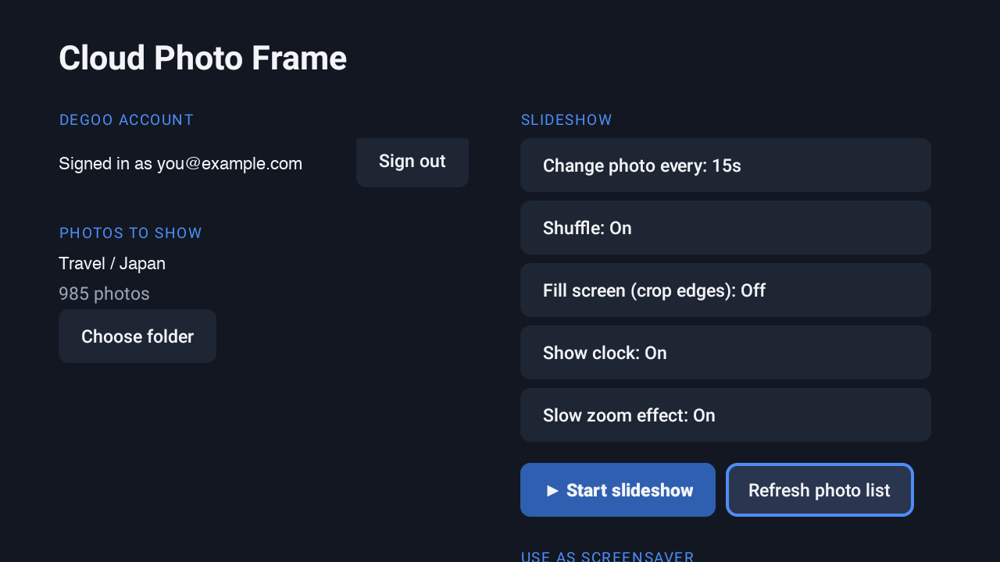

# Cloud Photo Frame

**An Android TV screensaver that shows photos from your Degoo cloud storage.**

Pick a folder, and whenever your TV goes idle it slowly fades through your photos, with an optional clock. I built it because my travel photos were sitting unseen in Degoo, and no app could show them on the TV.



> **Unofficial.** This project is not affiliated with, endorsed by or supported by Degoo. Degoo has no public API, so the app uses the same web API that app.degoo.com uses. It may stop working if Degoo changes that API. Use it with your own account, at your own risk.

## Features

- **Screensaver ("Daydream")** that starts when the TV is idle. You can also run the slideshow on demand from the app.
- **Any Degoo folder**, including its sub-folders. Folders are browsed with the TV remote.
- **Sign in from your phone:** the TV shows a local address and a 6-digit code, so you don't have to type a password with the remote.
- **Crossfades and an optional slow zoom.** Each photo shows for 10 seconds to 5 minutes, with shuffle or date order and fit or fill.
- **Clock and date overlay** that shifts slightly with each photo, so it doesn't burn into OLED screens.
- **Works offline:** the photo list is cached and refreshed twice a day, and recently shown photos are kept on the TV (up to 800 MB). If Degoo or the internet is unavailable, the screensaver keeps going with saved photos.
- **Reconnects by itself:** if Degoo ends the session, the app signs in again on its own (at most every 10 minutes). It uses your password, which is encrypted with a key held in the Android Keystore.

## Install

**Option 1 – download:** get `CloudPhotoFrame-1.0.apk` from the [Releases](../../releases) page.

**Option 2 – build it yourself** (requires JDK 17+ and Android SDK 37, both included with Android Studio):

```bash
./gradlew assembleRelease
```

The APK is created at `app/build/outputs/apk/release/app-release.apk`. It's signed with a debug key so it can be installed directly.

**Install on the TV:**
1. On the TV, go to **Settings → System → About** and press **Build** 7 times to unlock Developer options.
2. Turn on **USB debugging** (on some TVs it's called **Network debugging**).
3. From your computer, connect to the TV:

```bash
adb connect <TV-IP-address>
```

4. Then install the app:

```bash
adb install -r CloudPhotoFrame-1.0.apk
```

## Set it as the screensaver

**Android TV:** go to **Settings → Device Preferences → Screen saver** and choose **Cloud Photo Frame**.

**Google TV, Mi TV and some other TVs** hide third-party screensavers from Settings. Run this once from your computer while it's connected with adb:

```bash
adb shell settings put secure screensaver_components com.cloudframe.tv/.PhotoDreamService
```

To switch back later, first find out what your TV used originally:

```bash
adb shell settings get secure screensaver_components
```

Run that **before** changing the setting and note the result, so you can restore it.

## How it works

| Part | File |
|---|---|
| Degoo sign-in, folder listing, signed download links | `DegooApi.kt` |
| Cached photo list (refreshed every 12 hours) | `PhotoLibrary.kt` |
| Crossfading slideshow shared by the screensaver and the app | `SlideshowView.kt` |
| The screensaver itself | `PhotoDreamService.kt` |
| Phone sign-in page (local network only, protected by a code) | `SetupServer.kt` |
| Encrypted password storage | `CredentialStore.kt` |

Built with Kotlin, OkHttp and Coil, targeting Android TV 8.0+ (API 26). It was tested on a Xiaomi Mi TV running Android TV 11.

## Privacy

- **Your password** is kept on the TV, encrypted with a hardware-backed key in the Android Keystore. Signing out deletes it.
- **Your photos** go only from Degoo to your TV. Nothing is sent anywhere else.
- **The phone sign-in page** uses plain HTTP on your home network. It only runs while the setup screen is open and you're signed out, and it only accepts the code shown on the TV.

## Credits

- The Degoo web API details (endpoints, request shapes, and the web client's public API key) were learned from [bernd-wechner/Degoo](https://github.com/bernd-wechner/Degoo), © 2020 Bernd Wechner, licensed under the [Hippocratic License 2.1](https://github.com/bernd-wechner/Degoo/blob/master/LICENSE.md). This app is a separate implementation in Kotlin.
- Built with the help of [Claude Code](https://claude.com/claude-code).

## License

[MIT](LICENSE) for the code in this repository.
